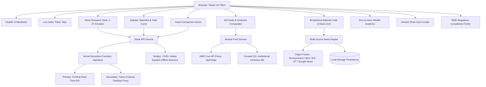

# 🏛️ THE MARKET DECK

### Real-Time Financial Intelligence, Institutional Equity Research & Wealth Literacy Terminal
*Mastering Indian & Global Equities, Live Wires, Mutual Fund Dossiers & Pure Mathematical Compounding*

[](https://market-deck-five.vercel.app/)

[](https://opensource.org/licenses/MIT)
[](https://linkedin.com/in/dhairya-dani07)
[](https://react.dev/)
[](https://vitejs.dev/)
[](https://developer.mozilla.org/en-US/docs/Web/CSS)
[](https://www.nseindia.com/)
[](https://www.amfiindia.com/)
[](#-sebi-regulatory-compliance--statutory-safeguards)
[](#)

---

> 🚀 **Official Live Production URL:** [https://market-deck-five.vercel.app/](https://market-deck-five.vercel.app/)  
> *Zero-configuration institutional broadsheet & financial intelligence terminal hosted on Vercel Edge Network with live Dalal Street tickers and AMFI NAV feeds.*

---

## 📌 Executive Overview

**The Market Deck** is an institutional-grade, modern personal financial cockpit designed for retail investors, equity analysts, and wealth builders. It unites the timeless editorial credibility of vintage financial broadsheets (*The Wall Street Journal*, *The Financial Times*) with the speed, data density, and interactive horsepower of professional terminals (*Bloomberg*, *FactSet*).

Unlike conventional clickbait news feeds and promotional trading apps that push speculative options and sponsored tips, **The Market Deck** enforces a strict **Zero-Hallucination & Zero-Fluff Standard**:

1. **Exchange-Direct Quotes & 52-Week Ranges:** Real-time stock ticks and historical charts fetched directly via a hardened API gateway (Finnhub + Yahoo Finance desktop proxies + curated 2,000+ Indian stock catalog).
2. **1-to-2 Year Institutional Equity Dossiers:** Verifiable corporate timelines, balance-sheet health, ROCE/ROIC metrics, and objective Bull vs. Bear cases across major Indian enterprises.
3. **Comprehensive Wealth Vehicles & Mutual Funds Comparator:** Live AMFI scheme lookup, real-time NAV calculations, portfolio weight breakdowns, and side-by-side asset comparison matrices across Bank FDs, Nifty Index Funds, Small/Mid/Flexi Caps, PPF, Sovereign Gold Bonds, and LIC policies.
4. **Multi-Source Dalal Street Live Wire:** Unfiltered real-time dispatches from *Moneycontrol, Livemint, Business Standard, The Economic Times, and Google News India*, intelligently classified into focused desks: **Regulation Patrol, Hiring & Talent, Global Dial, Tech Specs, Energy & Grid, Metal Shine, Politics, and Stonks Arena**.
5. **Deep Mathematical Compounding Models:** Charlie Munger's **Owner Earnings / ROIC vs. WACC** evaluation engine and dynamic **SIP Wealth Projection Calculators**.
6. **Investor Brain Gym Arcade:** Interactive cognitive challenges including mathematically validated Sudoku (with automated hint solver), 35-term randomized Finance Wordle, procedural Depth-First Search Canvas Mazes, and valuation trivia.

---

## 📸 Platform Visuals & Terminal Tour

### 1. Masthead & Terminal Dark Mode
> *Vintage broadsheet typography meets high-contrast terminal styling with real-time Dalal Street benchmarks.*


---

### 2. Comprehensive Funds & Wealth Schemes Comparator
> *In-depth dossiers for real-world mutual funds (e.g. HDFC Transportation, Quant Small Cap, Parag Parikh Flexi Cap), alongside historical statutory comparisons across Bank FDs, SIPs, PPF, and Gold.*


---

### 3. 1-to-2 Year Stock Intelligence Dossier
> *Institutional multi-year timelines, current operational catalysts, balance-sheet health, and verified Bull vs. Bear cases.*


---

### 4. Multi-Asset Comparison Arena & Duopolies (Zomato vs. Swiggy)
> *Head-to-head battles comparing valuations, revenue CAGR, platform gross order values, and operating moats.*


---

### 5. Zero-to-Hero Wealth Strategy Academy
> *Interactive SIP compounding calculator, financial freedom roadmaps, debt trap filters, and Munger mental models.*


---

### 6. Investor Brain Gym Arcade
> *Sharpen market instincts with mathematically validated Sudoku, 35-term randomized Finance Wordle, and financial literacy trivia.*


---

### 7. Classic Broadsheet Paper Mode
> *Instant toggle between Terminal Dark Mode (`#0a0c10`) and Vintage Cream Broadsheet (`#fbf8f1`).*


---

## ⚡ Core Features from A to Z

| Feature | Description | Architecture / Implementation |
| :--- | :--- | :--- |
| **All-Funds Comparator** | Compare 19+ curated real-world mutual funds + 10,000+ live AMFI schemes with expense ratios, sector weights, and historical returns. | `WealthFundsComparator.jsx` + `mutualFundService.js` (AMFI API) |
| **Asset Comparison Arena** | Compare 2 or 3 competing equities or asset classes across revenue, P/E, moat, and multi-year returns. | `AssetComparisonArena.jsx` + `assetComparisonDatabase.js` |
| **Auto-Refresh Engine** | Configurable countdown timer (5m, 15m, 30m, 60m, or manual) that refreshes live feeds and market quotes. | `newsService.js` interval worker + DOM listener |
| **Brain Gym: Sudoku** | 100% mathematically valid 9x9 grid with cell highlighting, keypad, verification check, and automated hint engine. | Validated Latin-square matrix + randomized empty-cell solver |
| **Brain Gym: Wordle** | 35-word randomized financial vocabulary puzzle with NYT-grade two-pass coloring and educational clues. | `BrainGym.jsx` + `defaultNews.js` dictionary |
| **Brain Gym: Canvas Maze** | Procedurally generated 15x15 DFS maze with keyboard arrow navigation and escape confetti. | HTML5 Canvas 2D API + Depth-First Search with backtracking |
| **Brain Gym: Market Trivia** | Financial ratio and corporate action literacy quizzes with instant mathematical explanations. | Dynamic trivia state with score tracking and confetti |
| **Brain Gym: Higher or Lower** | Valuation streak challenge guessing which entity commands higher market capitalization. | State streak counter with live asset valuation comparisons |
| **Catch Me Up Briefing** | 60-second synthesized 4-point executive briefing of the day's macro catalysts. | Custom modal with browser SpeechSynthesis audio dispatch |
| **Custom Company Watchlist** | Add ANY company on NSE/BSE to your personal radar with live debounced search and quick-pick chips. | `Sidebar.jsx`, `SettingsModal.jsx` + `stockApiService.js` |
| **Dossier Export** | One-click clipboard export of institutional equity research reports formatted for analysts. | Asynchronous `navigator.clipboard.writeText` with toast feedback |
| **Dual Aesthetic Design** | Switch effortlessly between *Terminal Dark Mode* and *Classic Vintage Broadsheet Paper*. | CSS Custom Properties token design system via `data-theme` |
| **Editorial Vibe Toggle** | Choose between *Wall Street Executive* (zero-fluff quantitative) and *Market Deck Alpha* (high-signal punchy). | Dynamic story synthesis based on tone preset |
| **Live Dalal Street Wire** | Aggregated real-time dispatches from *Moneycontrol, Livemint, Business Standard, ET, and CNBC-TV18*. | Multi-source RSS pipeline with local proxy fallback & deduplication |
| **Munger ROIC Filter** | Focuses strictly on owner earnings, deducting SBC dilution and verifying return on invested capital. | Mathematical ROIC vs. WACC evaluation engine |
| **Noise Filtering Engine** | Strips out promotional trading courses, penny-stock tips, and speculative clickbait. | Algorithmic filter flagging sponsored content and promotional keywords |
| **SEBI Compliance Footer** | Prominent statutory disclaimers, educational safety declarations, and anti-fraud warnings. | Non-advisory compliant footer in `App.jsx` |
| **SIP Wealth Simulator** | Interactive monthly SIP calculator calculating future wealth, total invested capital, and wealth gain multiplier. | Compound interest formula: $FV = P \times \frac{(1+r)^n - 1}{r} \times (1+r)$ |
| **Stock Deep-Dive Dossier** | Comprehensive 1-to-2 year timeline, live price ticks, 52W range, Bull/Bear thesis, and editorial verdict. | `StockResearchDesk.jsx` + Finnhub / Yahoo Gateway |
| **Text-to-Speech Audio Wire** | Hands-free browser speech engine narrating articles and executive briefings out loud. | Native browser `window.speechSynthesis` with speech rate tuning |
| **Zero-Hallucination Safe** | Zero fabricated stock prices. If a company does not exist on NSE/BSE, an explicit alert is displayed. | Hardened symbol validator with clean `notFound` status flags |

---

## 🏗️ Technical Architecture & Data Flow



### Core Technologies
* **Frontend Framework:** [React 19](https://react.dev/) + [Vite 5](https://vitejs.dev/) (blazing-fast HMR and 3.2s production bundle compilation).
* **Styling Architecture:** Pure, tailored **Vanilla CSS** (`src/index.css`) with 80+ CSS variables for typography, elevation, spacing, and seamless dark/light switching without framework overhead.
* **Vector Icons:** [Lucide React](https://lucide.dev/) (crisp, lightweight iconography).
* **Gamification:** [Canvas Confetti](https://www.npmjs.com/package/canvas-confetti) (reward animations for games, correct trivia, and research exports).
* **Audio & Accessibility:** Native Web Speech API (`SpeechSynthesisUtterance`) providing zero-latency text-to-speech for all dispatches.
* **Exchange & Mutual Fund Gateways:** Vercel Serverless Functions (`api/stock.js`) + Vite edge reverse proxies (`/api/yahoo`, `/api/mfapi`, `/api/mc-markets`, `/api/mint-markets`, `/api/gnews-india`).

---

## ⚖️ SEBI Regulatory Compliance & Statutory Safeguards

**The Market Deck** is engineered strictly as an educational and personal financial intelligence terminal. It complies with Indian securities regulations:

1. **Non-Advisory Status (SEBI RA / IA Regulations):** *The Market Deck* is **NOT** a SEBI-registered Investment Adviser (RIA) or Research Analyst (RA). It does not provide stock recommendations, price targets, or financial advice.
2. **Statutory Mutual Fund Notice:** All mutual fund screens prominently display: *"Mutual Fund investments are subject to market risks. Please read all scheme-related documents (SID / KIM) carefully before investing."*
3. **Factual Mathematical Formulations:** Ratios (P/E, ROIC, ROCE, Debt/Equity) and compounding calculations are strictly mathematical derivations of audited historical filings.
4. **Investor Charter Protection:** Explicit anti-fraud notices warn users never to share trading credentials or trust fraudulent social media groups promising guaranteed market returns.

---

## 🚀 Getting Started Locally

### Prerequisites
* **Node.js:** `v18.0.0` or higher (Node 20+ recommended)
* **npm:** `v9.0.0` or higher

### Installation & Launch

```bash
# 1. Clone the repository
git clone https://github.com/dhairya711/the-market-deck.git

# 2. Enter project directory
cd the-market-deck

# 3. Install dependencies
npm install

# 4. (Optional) Configure Finnhub API Key for live exchange ticks
cp .env.example .env
# Open .env and insert your free key from https://finnhub.io/register:
# FINNHUB_API_KEY=your_free_finnhub_api_key_here

# 5. Start local development server
npm run dev
```

Open your browser to `http://localhost:5173/`.

### Production Build & Lint Validation

```bash
# Verify linting
npm run lint

# Build optimized production bundle
npm run build

# Preview build locally
npm run preview
```

Production assets compile into `dist/` ready for zero-configuration static deployment on **Vercel**, **Netlify**, or **Cloudflare Pages**.

---

## 🌐 Deploying to Vercel (Production)

Deploying to Vercel takes under 60 seconds with 100% reliability:

1. **Get a Free Finnhub API Key:** Register at [finnhub.io/register](https://finnhub.io/register) (free, takes 30 seconds).
2. **Import to Vercel:** Go to [vercel.com/new](https://vercel.com/new) and import `dhairya711/the-market-deck`.
3. **Framework Settings (Auto-Detected):**
   * **Framework Preset:** `Vite`
   * **Build Command:** `npm run build`
   * **Output Directory:** `dist`
4. **Environment Variables:**
   * Add `FINNHUB_API_KEY` with your copied key.
5. **Click Deploy.** Your terminal will be live with full exchange proxying, RSS feeds, and AMFI schemes!

*Live Production Instance:* **[https://market-deck-five.vercel.app/](https://market-deck-five.vercel.app/)**

---

## 👨‍💻 Author & Maintainer

* **Architect & Engineer:** **Dhairya Dani**
* **LinkedIn:** [linkedin.com/in/dhairya-dani07](https://linkedin.com/in/dhairya-dani07)
* **GitHub:** [@dhairya711](https://github.com/dhairya711)

---

## 🛡️ License

This project is licensed under the **MIT License** — feel free to explore, customize, and build upon it.

---

*Engineered with precision for modern financial literacy and institutional equity analysis.*
