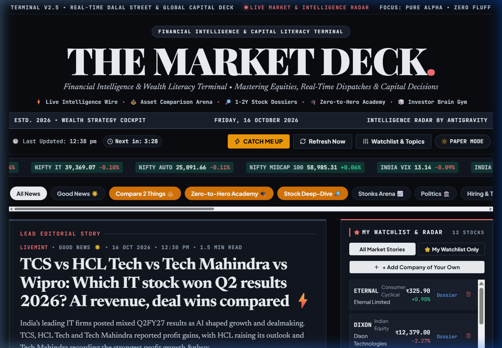
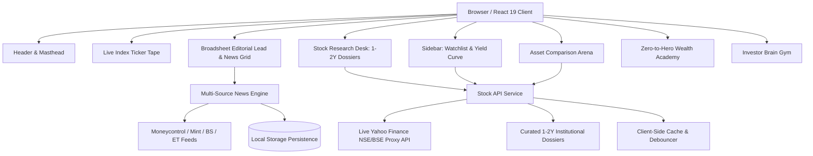

# 🏛️ THE MARKET DECK

### Financial Intelligence & Wealth Literacy Terminal • Mastering Equities, Real-Time Dispatches & Capital Decisions

[](https://opensource.org/licenses/MIT)
[](https://react.dev/)
[](https://vitejs.dev/)
[](https://developer.mozilla.org/en-US/docs/Web/CSS)
[](https://www.nseindia.com/)
[](#)

---

## 📌 Executive Overview

**The Market Deck** is an institutional-grade, modern personal financial cockpit designed for retail investors, equity analysts, and wealth builders. It unites the timeless credibility of vintage financial broadsheets (*The Wall Street Journal*, *The Financial Times*) with the speed, data density, and interactive horsepower of professional terminals (*Bloomberg*, *FactSet*).

Unlike conventional clickbait news feeds and promotional trading apps, **The Market Deck** operates on a strict **Zero-Hallucination & Zero-Fluff Standard**:
- Real-time stock quotes and 52-week ranges fetched directly from live NSE/BSE exchange endpoints.
- Verifiable 1-to-2 year corporate timelines and balance-sheet deep dives for Indian equities.
- Deep mathematical frameworks for long-term compounding, including Charlie Munger's **Owner Earnings / ROIC vs. WACC** metric and dynamic **SIP Wealth Projection Engines**.
- Interactive **Asset Comparison Arena** comparing valuations, moats, and balance sheets across competing giants (e.g. *Zomato vs. Swiggy*, *TCS vs. Infosys*).
- An **Investor Brain Gym** featuring mathematically verified Sudoku with real-time hint validation, randomized 35-term Finance Wordle, procedural mazes, and financial literacy trivia.

---

## 📸 Platform Visuals & Live Tour

### 1. Masthead & Terminal Dark Mode
> *Vintage broadsheet elegance meets modern high-contrast terminal styling with real-time Dalal Street indices.*


---

### 2. My Watchlist & Portfolio Radar (Custom Company Add)
> *Search and add any company across 2,000+ Indian listed equities on demand, with live price ticks and instant dossier triggers.*



---

### 3. 1-to-2 Year Stock Intelligence Dossier
> *Institutional multi-year timelines, current operational catalysts, balance-sheet health, and verified Bull vs. Bear cases.*


---

### 4. Multi-Asset Comparison Arena
> *Head-to-head 3-way battles analyzing market caps, 1Y/2Y returns, P/E multiples, operating margins, and moat resilience.*


---

### 5. Duopoly & Direct Competitor Deep-Dive (Zomato vs. Swiggy)
> *Direct rivalry analysis with side-by-side metrics, revenue CAGR, platform gross order values, and strategic verdicts.*


---

### 6. Zero-to-Hero Wealth Strategy Academy
> *Interactive SIP compounding calculator, financial freedom roadmaps, debt trap filters, and Munger mental models.*


---

### 7. Investor Brain Gym
> *Sharpen market instincts with mathematically validated Sudoku (with hint solver), 35-term randomized Finance Wordle, and financial literacy trivia.*


---

### 8. Classic Broadsheet Paper Mode
> *Instant toggle between Terminal Dark Mode (`#0a0c10`) and Vintage Cream Broadsheet (`#fbf8f1`).*


---

## ⚡ Core Features from A to Z

| Feature | Description | Architecture / Implementation |
| :--- | :--- | :--- |
| **Asset Comparison Arena** | Compare 2 or 3 competing equities or asset classes across revenue, P/E, moat, and multi-year returns. | `AssetComparisonArena.jsx` + `assetComparisonDatabase.js` |
| **Auto-Refresh Engine** | Configurable countdown timer (5m, 15m, 30m, 60m, or manual) that refreshes live feeds and market quotes. | `newsService.js` interval worker + DOM listener |
| **Brain Gym: Sudoku** | 100% mathematically valid 9x9 grid with cell highlighting, keypad, verification check, and automated hint engine. | Validated Latin-square matrix + randomized empty-cell solver |
| **Brain Gym: Wordle** | 35-word randomized financial vocabulary puzzle with NYT-grade two-pass coloring and educational clues. | `BrainGym.jsx` + `defaultNews.js` dictionary |
| **Brain Gym: Canvas Maze** | Procedurally generated 15x15 DFS maze with keyboard arrow navigation and escape confetti. | HTML5 Canvas 2D API + Depth-First Search with backtracking |
| **Brain Gym: Market Trivia** | Financial ratio and corporate action literacy quizzes with instant mathematical explanations. | Dynamic trivia state with score tracking and confetti |
| **Brain Gym: Higher or Lower** | Valuation streak challenge guessing which entity commands higher market capitalization. | State streak counter with live asset valuation comparisons |
| **Catch Me Up Briefing** | 60-second synthesized 4-point executive briefing of the day's macro catalysts. | Custom modal with browser SpeechSynthesis audio dispatch |
| **Custom Company Watchlist** | Add ANY company on NSE/BSE to your personal radar with live debounced search and quick-pick chips. | `Sidebar.jsx`, `SettingsModal.jsx` + `stockApiService.js` |
| **Dossier Export** | One-click clipboard export of institutional equity research reports formatted for analysts. | Asynchronous `navigator.clipboard.writeText` with toast feedback |
| **Dual Aesthetic Design** | Switch effortlessly between *Terminal Dark Mode* and *Classic Vintage Broadsheet Paper*. | CSS Custom Properties token design system via `data-theme` |
| **Editorial Vibe Toggle** | Choose between *Wall Street Executive* (zero-fluff quantitative) and *TFG Style* (high-signal punchy). | Dynamic story synthesis based on tone preset |
| **Live Dalal Street Wire** | Aggregated real-time dispatches from *Moneycontrol, Livemint, Business Standard, ET, and CNBC-TV18*. | Multi-source RSS pipeline with local proxy fallback & deduplication |
| **Munger ROIC Filter** | Focuses strictly on owner earnings, deducting SBC dilution and verifying return on invested capital. | Mathematical ROIC vs. WACC evaluation engine |
| **Noise Filtering Engine** | Strips out promotional trading courses, penny-stock tips, and speculative clickbait. | Algorithmic filter flagging sponsored content and promotional keywords |
| **SIP Wealth Simulator** | Interactive monthly SIP calculator calculating future wealth, total invested capital, and wealth gain multiplier. | Compound interest formula: $FV = P \times \frac{(1+r)^n - 1}{r} \times (1+r)$ |
| **Stock Deep-Dive Dossier** | Comprehensive 1-to-2 year timeline, live price ticks, 52W range, Bull/Bear thesis, and editorial verdict. | `StockResearchDesk.jsx` + Yahoo Finance Chart API integration |
| **Text-to-Speech Audio Wire** | Hands-free browser speech engine narrating articles and executive briefings out loud. | Native browser `window.speechSynthesis` with speech rate tuning |
| **Zero-Hallucination Safe** | Zero fabricated stock prices. If a company does not exist on NSE/BSE, an explicit alert is displayed. | Hardened symbol validator with clean `notFound` status flags |

---

## 🏗️ Architecture & Technical Stack



### Core Technologies
- **Frontend Core**: [React 19](https://react.dev/) + [Vite 5](https://vitejs.dev/) (lightning-fast HMR and 3.2s production bundle compilation).
- **Styling Architecture**: Pure, tailored **Vanilla CSS** (`src/index.css`) with 80+ CSS variables for typography, elevation, spacing, and seamless dark/light switching without framework overhead.
- **Icons**: [Lucide React](https://lucide.dev/) (consistent, crisp vector iconography).
- **Gamification**: [Canvas Confetti](https://www.npmjs.com/package/canvas-confetti) (reward animations for games, correct trivia, and research exports).
- **Audio & Accessibility**: Native Web Speech API (`SpeechSynthesisUtterance`) providing zero-latency text-to-speech for all dispatches.
- **Data & Exchange APIs**: Vite proxy endpoints connecting to live Yahoo Finance quotes (`.NS` / `.BO`) and multi-source Indian financial RSS feeds.

---

## 📐 Detailed Documentation Directory

In-depth technical papers and architectural deep dives are organized in the [`docs/`](docs/) directory:

1. [**`docs/ARCHITECTURE_AND_DESIGN_DECISIONS.md`**](docs/ARCHITECTURE_AND_DESIGN_DECISIONS.md)
   - Deep dive into UI tokens, typography system, state management patterns, API proxying, and client-side memory caching.
2. [**`docs/FINANCIAL_ENGINE_AND_METHODOLOGY.md`**](docs/FINANCIAL_ENGINE_AND_METHODOLOGY.md)
   - Complete mathematical breakdown of the SIP engine, ROIC vs. WACC evaluation, 1-to-2 year timeline construction, and Indian stock market structure.
3. [**`docs/PROJECT_CHRONICLE_AND_DECISIONS.md`**](docs/PROJECT_CHRONICLE_AND_DECISIONS.md)
   - The end-to-end engineering journey: how naming evolved to *The Market Deck*, fixing the Sudoku mathematical defect, randomizing Wordle dictionary selection, and resume highlights.

---

## 🚀 Getting Started Locally

### Prerequisites
- **Node.js**: `v18.0.0` or higher (Node 20+ recommended)
- **npm**: `v9.0.0` or higher

### Installation & Launch

```bash
# 1. Clone the repository
git clone https://github.com/dhairya711/the-market-deck.git

# 2. Enter directory
cd the-market-deck

# 3. Install dependencies
npm install

# 4. Start local development server
npm run dev
```

Open your browser to `http://localhost:5173/`.

### Production Build

```bash
# Build optimized production bundle
npm run build

# Preview build locally
npm run preview
```

Production assets compile into `dist/` ready for zero-configuration static deployment on **Vercel**, **Netlify**, or **Cloudflare Pages**.

---

## 🛡️ License

This project is licensed under the **MIT License** — feel free to explore, customize, and build upon it.

---

*Engineered with precision for modern financial literacy and institutional equity analysis.*
