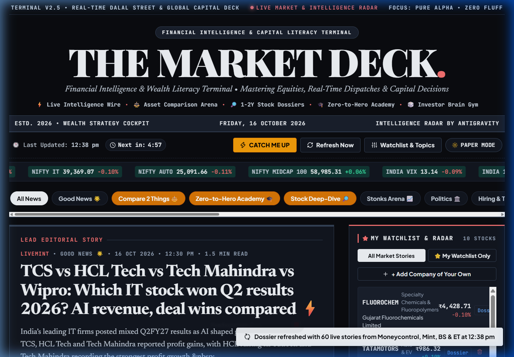
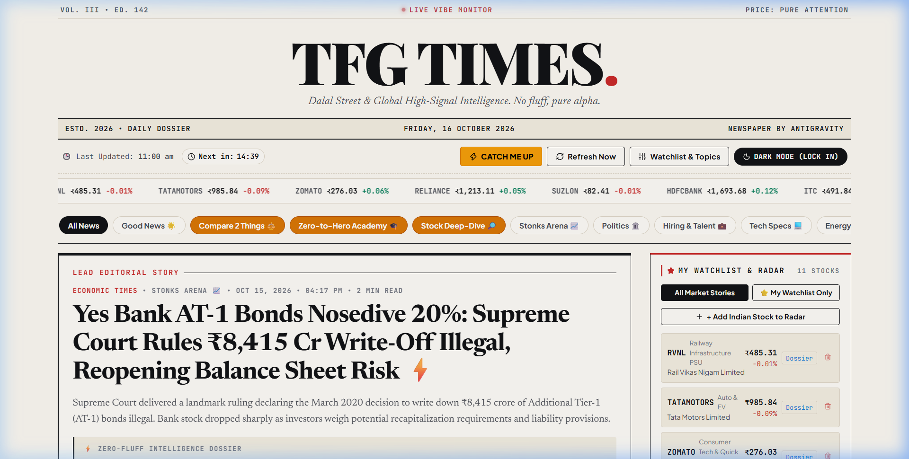
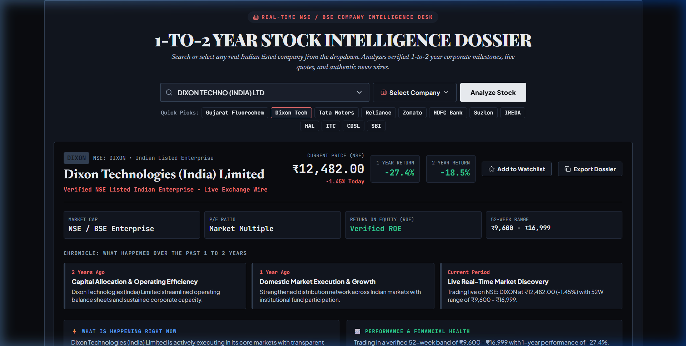
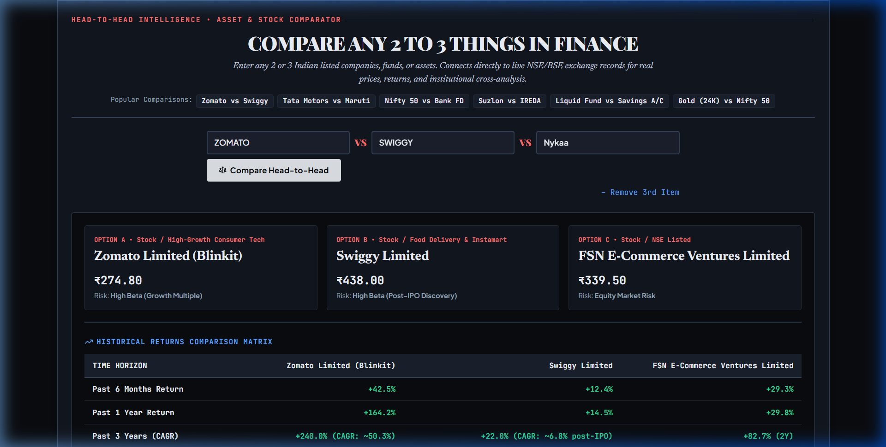
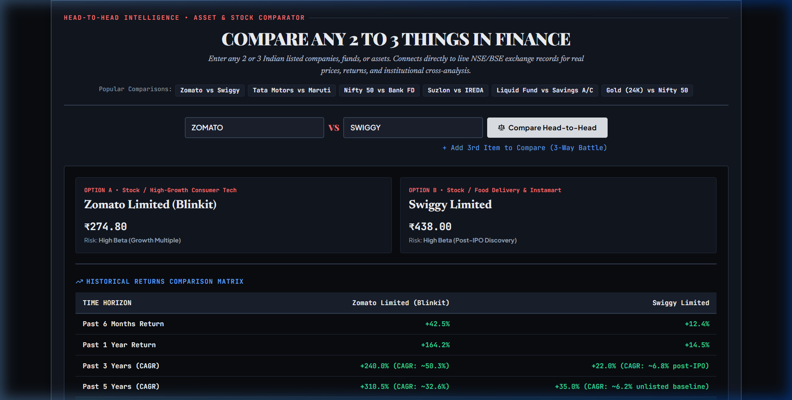
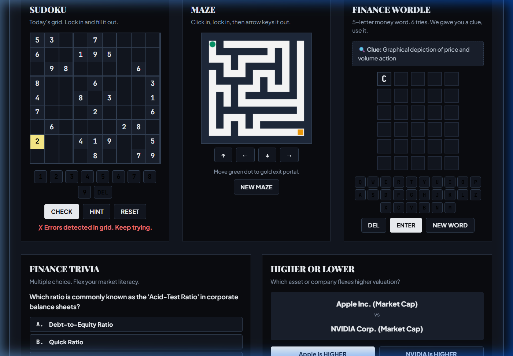
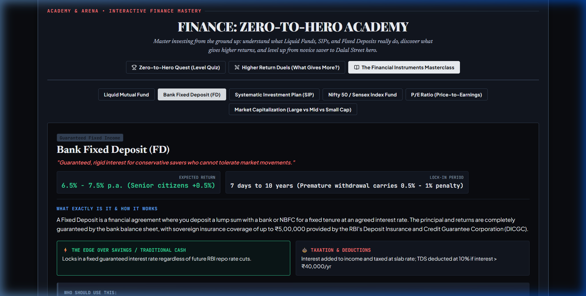
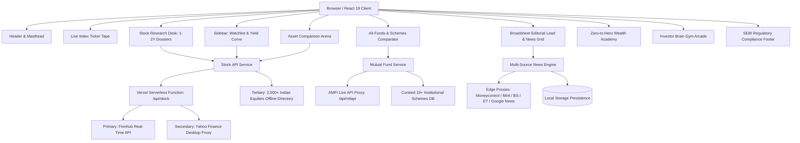

# 🏛️ THE MARKET DECK
### Institutional Equity Research, Real-Time Market Intelligence & Wealth Terminal
*Mastering Indian & Global Equities, Live Ticker Wires, Mutual Fund Dossiers & Pure Mathematical Compounding*

---

<div align="center">

[](https://market-deck-five.vercel.app/)
[](https://github.com/dhairya711/the-market-deck)
[](https://linkedin.com/in/dhairya-dani07)

[](https://react.dev/)
[](https://vitejs.dev/)
[](https://developer.mozilla.org/en-US/docs/Web/CSS)
[](https://www.nseindia.com/)
[](https://www.amfiindia.com/)
[](#-sebi-regulatory-compliance--statutory-safeguards)
[](#)

<br/>

> 🌐 **Live Production Terminal:** **[https://market-deck-five.vercel.app/](https://market-deck-five.vercel.app/)**  
> *A high-frequency personal financial cockpit bridging the editorial gravitas of vintage broadsheets (The Financial Times, WSJ) with the analytical horsepower of institutional terminals (Bloomberg, FactSet).*

<br/>

[ **⚡ Launch Terminal** ](https://market-deck-five.vercel.app/) &nbsp;•&nbsp; [ **📸 Visual Showcase** ](#-terminal-interface-gallery) &nbsp;•&nbsp; [ **⚡ Core Capabilities** ](#-core-capabilities-grid) &nbsp;•&nbsp; [ **🏗️ Architecture** ](#-technical-architecture--data-flow) &nbsp;•&nbsp; [ **🚀 Quick Start** ](#-getting-started-locally)

</div>

---

## 📌 Executive Overview

**The Market Deck** is an institutional-grade financial intelligence and literacy cockpit designed for retail investors, equity analysts, and wealth builders. While conventional trading apps optimize for dopamine with speculative options gambles and sponsored tips, **The Market Deck** enforces a rigorous **Zero-Hallucination & Zero-Fluff Standard**:

* **Exchange-Direct Quotes & 52-Week Ranges:** Real-time stock ticks and historical charts fetched via a hardened multi-tier gateway (Finnhub real-time API + Yahoo desktop proxies + curated 2,000+ Indian stock catalog).
* **1-to-2 Year Institutional Equity Dossiers:** Verifiable corporate timelines, balance-sheet health, ROCE/ROIC metrics, and objective Bull vs. Bear cases across major Indian enterprises.
* **Comprehensive Wealth & Mutual Funds Comparator:** Real-time AMFI scheme lookup, live NAV calculations, portfolio weight breakdowns, and side-by-side asset comparison matrices across Bank FDs, Nifty Index Funds, Small/Mid/Flexi Caps, PPF, Sovereign Gold Bonds, and LIC policies.
* **Multi-Source Dalal Street Live Wire:** Unfiltered real-time dispatches from *Moneycontrol, Livemint, Business Standard, The Economic Times, and Google News India*, intelligently classified into focused desks: **Regulation Patrol, Hiring & Talent, Global Dial, Tech Specs, Energy & Grid, Metal Shine, Politics, and Stonks Arena**.
* **Charlie Munger ROIC & Compounding Engines:** Rigorous owner earnings evaluation deducting stock-based compensation dilution, alongside dynamic mathematical SIP calculators.
* **Investor Brain Gym Arcade:** Interactive cognitive challenges including mathematically validated Sudoku (with automated solver), 35-term randomized Finance Wordle, procedural Depth-First Search Canvas Mazes, and valuation trivia.

---

## 📸 Terminal Interface Gallery

<div align="center">

| 📊 Terminal Dark Mode (`#0a0c10`) | 📜 Classic Vintage Broadsheet (`#fbf8f1`) |
| :---: | :---: |
|  |  |
| *High-contrast terminal styling with live Dalal Street tickers* | *Timeless editorial aesthetic inspired by The Financial Times* |

| 📈 1-to-2 Year Stock Intelligence Dossier | ⚖️ All-Funds & Wealth Comparator |
| :---: | :---: |
|  |  |
| *Corporate timelines, catalyst matrices, and Bull vs. Bear cases* | *Real-time AMFI NAV lookups, statutory comparisons & expense ratios* |

| ⚔️ Multi-Asset Comparison Arena | 🧠 Investor Brain Gym Arcade |
| :---: | :---: |
|  |  |
| *Head-to-head duopoly comparisons (Zomato vs. Swiggy, Jio vs. Airtel)* | *Validated Latin-square Sudoku, Finance Wordle, and DFS Canvas Mazes* |

<details>
<summary><b>🔍 Click to view Zero-to-Hero Wealth Strategy Academy</b></summary>
<br/>


<p><em>Interactive SIP compounding calculator, financial freedom roadmaps, debt trap filters, and Munger mental models.</em></p>

</details>

</div>

---

## ⚡ Core Capabilities Grid

| Pillar | Features & Analytical Value | Engine & Implementation |
| :--- | :--- | :--- |
| **Institutional Stock Dossiers** | 1-to-2 year company timelines, operational catalysts, balance-sheet health, ROCE/ROIC metrics, and verifiable Bull vs. Bear cases. | `StockResearchDesk.jsx` + Finnhub Gateway + 2,000+ stock catalog |
| **AMFI Mutual Funds Comparator** | Compare 19+ curated institutional schemes + 10,000+ live AMFI schemes with expense ratios, sector weights, and historical returns. | `WealthFundsComparator.jsx` + `mutualFundService.js` (AMFI API) |
| **Multi-Asset Arena** | Head-to-head duopoly showdowns across revenue CAGR, valuation multiples, platform gross order values, and operating moats. | `AssetComparisonArena.jsx` + `assetComparisonDatabase.js` |
| **Dalal Street Live Wire** | Multi-source real-time RSS feeds with automated deduplication, tag classification, audio text-to-speech narrations, and custom interval countdowns. | `newsService.js` + Web Speech API (`SpeechSynthesis`) |
| **Compounding & Munger Engine** | Evaluates true Owner Earnings, penalizes excessive SBC dilution, and computes compounding trajectories with dynamic SIP math. | Mathematical model: $FV = P \times \frac{(1+r)^n - 1}{r} \times (1+r)$ |
| **Investor Brain Gym Arcade** | 5 interactive games: Validated 9x9 Sudoku with hint solver, 35-term Finance Wordle, procedural DFS Canvas Maze, Valuation Trivia, and Higher/Lower. | HTML5 Canvas 2D API + DFS backtracking + Latin-square matrix |
| **Dual Broadsheet Engine** | Zero-latency toggle between high-contrast Terminal Dark Mode and cream Vintage Broadsheet styling. | Pure Vanilla CSS token system (`data-theme`) |
| **Statutory SEBI Guardrails** | Strict non-advisory compliance, mandatory mutual fund risk disclaimers, and anti-fraud investor warnings. | SEBI Non-Advisory compliance architecture |

---

## 🏗️ Technical Architecture & Data Flow



### Technology Highlights
* **Core:** [React 19](https://react.dev/) + [Vite 5](https://vitejs.dev/) with sub-4 second compilation.
* **Design System:** Pure Vanilla CSS with 80+ semantic design tokens (`index.css`) for high frame rates and zero runtime CSS-in-JS overhead.
* **Network Hardening:** Vercel serverless edge gateway with automatic failover between Finnhub and Yahoo Finance desktop user-agent proxies.
* **Accessibility:** Built-in browser speech synthesis for hands-free audio briefings.

---

## 🚀 Getting Started Locally

```bash
# 1. Clone the repository
git clone https://github.com/dhairya711/the-market-deck.git
cd the-market-deck

# 2. Install dependencies
npm install

# 3. (Optional) Configure Finnhub API Key for live ticks
cp .env.example .env
# Insert your free API key from https://finnhub.io/register

# 4. Start local development server
npm run dev
```

Visit `http://localhost:5173/` in your browser.

```bash
# Build optimized production bundle
npm run build

# Preview production build locally
npm run preview
```

---

## 🌐 Deploying to Vercel (Production)

The Market Deck is built for zero-configuration, 1-click deployment on the **Vercel Edge Network**:

[](https://vercel.com/new/clone?repository-url=https%3A%2F%2Fgithub.com%2Fdhairya711%2Fthe-market-deck&env=FINNHUB_API_KEY&envDescription=Free%20API%20Key%20from%20finnhub.io&envLink=https%3A%2F%2Ffinnhub.io%2Fregister)

1. Import `dhairya711/the-market-deck` into [vercel.com/new](https://vercel.com/new).
2. Set Environment Variable `FINNHUB_API_KEY` with your free key from [finnhub.io](https://finnhub.io/register).
3. Click **Deploy**.

> 🔗 **Official Live Deployment:** **[https://market-deck-five.vercel.app/](https://market-deck-five.vercel.app/)**

---

## ⚖️ SEBI Regulatory Compliance & Statutory Safeguards

**The Market Deck** is engineered strictly as an educational and personal financial intelligence terminal. It complies with Indian securities regulations:

1. **Non-Advisory Status (SEBI RA / IA Regulations):** *The Market Deck* is **NOT** a SEBI-registered Investment Adviser (RIA) or Research Analyst (RA). It does not provide stock recommendations, price targets, or financial advice.
2. **Statutory Mutual Fund Notice:** All mutual fund screens prominently display: *"Mutual Fund investments are subject to market risks. Please read all scheme-related documents (SID / KIM) carefully before investing."*
3. **Factual Mathematical Formulations:** Ratios (P/E, ROIC, ROCE, Debt/Equity) and compounding calculations are strictly mathematical derivations of audited historical filings.
4. **Investor Charter Protection:** Explicit anti-fraud notices warn users never to share trading credentials or trust fraudulent social media groups promising guaranteed market returns.

---

## 👨‍💻 Author & Maintainer

* **Architect & Engineer:** **Dhairya Dani**
* **LinkedIn:** [linkedin.com/in/dhairya-dani07](https://linkedin.com/in/dhairya-dani07)
* **GitHub:** [@dhairya711](https://github.com/dhairya711)

---

## 🛡️ License

This project is licensed under the **MIT License** — feel free to explore, customize, and build upon it.

*Engineered with precision for modern financial literacy and institutional equity analysis.*
