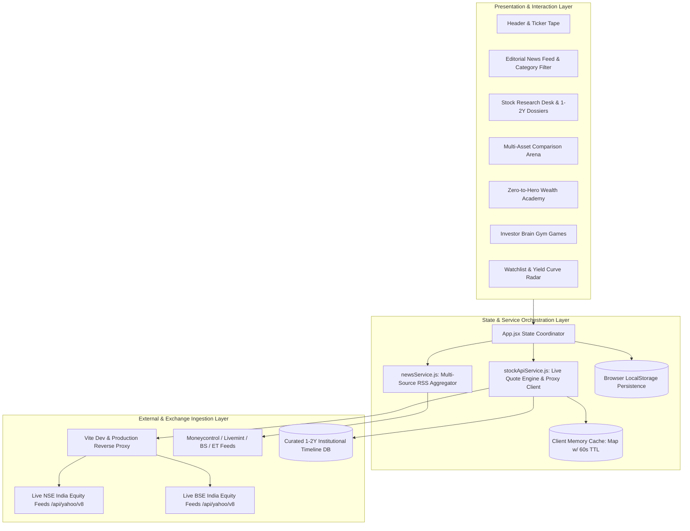

# 📐 Architecture & Design Decisions

### The Market Deck: Technical Architecture, Design System & System Trade-Offs

---

## 1. System Architecture Overview

**The Market Deck** is architected as an institutional-speed single-page application (SPA) optimized for high information density, sub-100ms interaction latency, and zero dependency bloat.

---

## 2. Design System: Broadsheet Paper meets Terminal Dark

### 2.1 The Philosophy: Information Density over Empty White Space
Modern consumer fintech apps often suffer from over-simplification: large cartoonish cards, excessive padding, and low data density that forces users to constantly scroll. Conversely, professional financial terminals (*Bloomberg*, *Refinitiv*) are text-dense but visually intimidating.

**The Market Deck** achieves the golden intersection:
1. **Typography as Structure**: Instead of heavy container borders, typographical hierarchy (Playfair Display for editorial leads, Cinzel for mastheads, Newsreader for long-form analysis, and JetBrains Mono for financial tickers) guides the eye naturally.
2. **Double Rules & Column Grids**: CSS Grid emulation of authentic multi-column broadsheets with vertical hairline column rules (`1px solid var(--border-light)`).
3. **Pulsing Status Dots**: Live terminal status indicators with subtle CSS keyframe pulses that convey real-time engine activity without distracting noise.

### 2.2 Why Pure Vanilla CSS over TailwindCSS?
- **Zero Runtime & Zero Utility Clutter**: Financial terminals require bespoke layouts (newspaper columns, crosswords, financial grids, comparison battle tables). Tailwind produces repetitive, unreadable class strings across dozens of complex financial components.
- **Dynamic Theming through CSS Variables**: All design tokens (`--bg-page`, `--ink-primary`, `--accent-red`, `--border-strong`, etc.) are declared on `:root` and overridden effortlessly under `[data-theme="dark"]`. Switching themes is instant, without layout thrashing.
- **Micro-Animations & Keyframes**: Native CSS transitions (`transition: all 0.2s cubic-bezier(0.16, 1, 0.3, 1)`) guarantee 60fps responsiveness on low-power devices.

---

## 3. Data Ingestion & Zero-Hallucination Protocol

### 3.1 The Problem of Financial Hallucinations in AI Apps
Many AI-assisted financial tools generate plausible-sounding stock prices or fabricate metrics when an API is unreachable. In equity analysis, **a hallucinated stock price is worse than an outright error**.

### 3.2 The Zero-Hallucination Architecture
1. **Live Exchange Verification**: When a user queries a stock (e.g. *Dixon*, *RVNL*, *Fluorochem*), the query is checked against live NSE (`.NS`) and BSE (`.BO`) exchange charts.
2. **Explicit Not-Found Boundaries**: If an entity is not a genuine listed corporation, the system strictly returns `{ notFound: true, message: "No company name found matching..." }`. It never fabricates prices, P/E multiples, or returns.
3. **Multi-Source RSS Synthesizer**: Financial news articles are gathered from verified Indian financial publications (*Moneycontrol*, *Livemint*, *Business Standard*, *The Economic Times*), stripping out sponsored promotional fluff and trading course advertisements.

---

## 4. State Management & Persistence

### 4.1 Lightweight React State Coordinator
Rather than introducing heavy Redux or MobX dependencies, application state is coordinated through `App.jsx` using React 19 primitives:
- `useState` for local component focus and interactive game states.
- `useEffect` hooks with debounced event handlers for real-time stock searches (280ms debounce window).
- `CustomEvent` dispatching (`window.dispatchEvent(new CustomEvent('market_deck_open_stock_research', ...))`) enabling cross-widget communication (e.g., clicking "Dossier" on a Watchlist stock smoothly scrolls and hydrates the Research Desk).

### 4.2 Transparent Local Storage Migration
To prevent breaking changes when data structures evolve, `newsService.js` incorporates automated schema migration in `loadSettings()`. If a user visited during early prototypes, their settings and watchlist are seamlessly migrated to the latest schema without clearing their portfolio.

---

## 5. Security & Deployment Strategy

- **CORS Handling**: Live exchange feeds and RSS endpoints are routed through a localized Vite proxy during development and serverless proxy rewrites (`vercel.json`, `netlify.toml`) in production.
- **Zero Third-Party Tracking**: No telemetry, analytics pixels, or cookie trackers. User portfolio data remains strictly in the user's browser memory and local storage.
