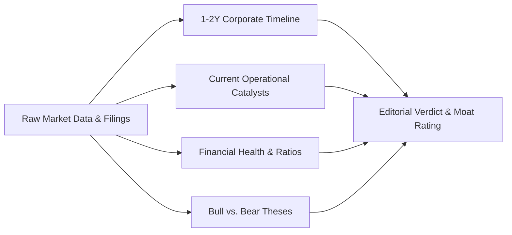

# 📊 Financial Engine & Methodology

### The Quantitative & Qualitative Frameworks Driving The Market Deck

---

## 1. The 1-to-2 Year Stock Intelligence Dossier Framework

Most market commentary is fixated on 15-minute intraday noise or vague 10-year projections. Institutional investors, however, make capital allocation decisions across a **1-to-2 year operational horizon**.

**The Market Deck** organizes equity analysis into five structured pillars:

### 1.1 Multi-Year Timeline Reconstruction
For each covered enterprise (e.g. *Gujarat Fluorochemicals*, *Tata Motors*, *Dixon Technologies*, *Reliance Industries*, *Infosys*, *Zomato*), the timeline tracks real corporate actions:
- **Capital Expenditure (CapEx) Cycles**: Factory commissions, capacity expansions, and clean-energy backward integration.
- **Supply Chain Pivot Points**: Raw material inflation, semiconductor shortages, or export tariff shifts.
- **De-leveraging Trajectory**: Net debt-to-EBITDA milestones and corporate restructuring (e.g. Tata Motors commercial vs. passenger vehicle demergers).

### 1.2 Bull vs. Bear Case Dialectic
Every stock dossier enforces an objective counter-balance:
- **The Bull Case**: Scalable competitive advantages, pricing power, return on equity (ROE) expansion, and secular tailwinds.
- **The Bear Case**: Commodity cycle downturns, geopolitical export duties, customer concentration risk, and multiple contraction.

---

## 2. Charlie Munger's Earnings Quality & ROIC Filter

> *"Over the long term, it’s hard for a stock to earn a much better return than the business which underlies it earns. If the business earns six percent on capital over forty years and you hold it for that forty years, you’re not going to make much different than a six percent return—even if you originally bought it at a huge discount."*  
> — **Charlie Munger**

### 2.1 The EBITDA Fallacy
Corporate earnings releases frequently emphasize "Adjusted EBITDA" to obscure real expenses. In **The Market Deck** methodology:
1. **Stock-Based Compensation (SBC) is a Real Expense**: Dilution reduces existing shareholder claims on future cash flows and must be deducted from operating cash flow.
2. **Maintenance CapEx vs. Growth CapEx**: Depreciation cannot be ignored; machinery, servers, and logistics fleets wear out and require ongoing cash reinvestment.
3. **Owner Earnings Formulation**:
   $$\text{Owner Earnings} = \text{Operating Cash Flow} - \text{Maintenance CapEx} - \text{SBC Dilution}$$

### 2.2 ROIC vs. WACC Hurdle Rate
- **ROIC (Return on Invested Capital)**: Measures how efficiently management generates post-tax operating profit from debt and equity capital.
- **WACC (Weighted Average Cost of Capital)**: The minimum return required by lenders and shareholders.
- **Economic Value Added (EVA)**: If $\text{ROIC} > \text{WACC}$, the business compounds intrinsic value monotonically. If $\text{ROIC} < \text{WACC}$, revenue growth actively destroys economic capital.

---

## 3. The Systematic Investment Plan (SIP) Compounding Engine

The **Zero-to-Hero Academy** features a live mathematical compounding simulator allowing wealth builders to calculate future portfolio value under dynamic monthly contributions, multi-decade horizons, and expected equity returns.

### 3.1 Mathematical Derivation
For monthly investments of $P$ at an annual return rate of $R$ across $N$ years:
- Monthly interest rate: $r = \frac{R}{12 \times 100}$
- Total compounding periods: $n = N \times 12$
- **Future Value Formula (Annuity Due)**:
  $$\text{Future Value } (FV) = P \times \frac{(1 + r)^n - 1}{r} \times (1 + r)$$

### 3.2 Total Invested vs. Wealth Multiplier
$$\text{Total Invested} = P \times n$$
$$\text{Estimated Wealth Gain} = FV - \text{Total Invested}$$
$$\text{Wealth Multiplier} = \frac{FV}{\text{Total Invested}}$$

### 3.3 Rule of 72 & Compound Time Horizon
The engine demonstrates why **time in the market dwarfs timing the market**:
- At 12% CAGR, investments double every $\frac{72}{12} = 6$ years.
- Over 24 years, capital undergoes 4 doubling cycles ($2^4 = 16\times$).
- The vast majority of gains accrue in the final 5 years of a 20-year horizon, proving the mathematical necessity of patient capital.

---

## 4. Multi-Asset Comparison Algorithm

In the **Asset Comparison Arena**, competing equities and asset classes are evaluated across a standardized 6-factor matrix:

| Factor | Evaluation Metric | Ideal Criterion |
| :--- | :--- | :--- |
| **Valuation Multiple** | Trailing & Forward P/E vs. Sector Median | Reasonable PEG ratio ($\le 1.5$) |
| **Return Profile** | 1-Year & 2-Year Compound Capital Return | Outperformance vs. Nifty 50 Index |
| **Margin Expansion** | Operating & Net Profit Margin Trend | Upward or resilient through macro cycles |
| **Capital Intensity** | Free Cash Flow Conversion Rate | High FCF / Net Income ratio ($\ge 75\%$) |
| **Economic Moat** | Switching costs, network effects, brand pricing power | Wide / Defensible Moat |
| **Risk / Volatility** | Maximum drawdown and balance-sheet leverage | Low Debt-to-Equity ($\le 0.5$) |

---

## 5. Indian Equities Market Architecture (NSE & BSE)

### 5.1 Dual-Exchange Routing
- **NSE (National Stock Exchange)**: The primary venue for liquidity and derivatives (`.NS` ticker suffix).
- **BSE (Bombay Stock Exchange)**: The historic exchange housing older listings and small-caps (`.BO` ticker suffix).
- **Routing Protocol**: Queries automatically attempt primary settlement via NSE. If an equity is listed exclusively on BSE, the proxy gracefully switches without user intervention.

### 5.2 Dalal Street Ticker Aliases
Many prominent Indian companies trade under corporate entity names that diverge from consumer brands. **The Market Deck** provides an automated alias resolver:
- `"Zomato"` $\rightarrow$ `ETERNAL` (Eternal Limited / Zomato)
- `"Tata Motors"` $\rightarrow$ `TATAMOTORS`
- `"Reliance"` $\rightarrow$ `RELIANCE`
- `"Gujarat Fluorochemicals"` $\rightarrow$ `FLUOROCHEM`
- `"Rail Vikas Nigam"` $\rightarrow$ `RVNL`
- `"Dixon Technologies"` $\rightarrow$ `DIXON`
